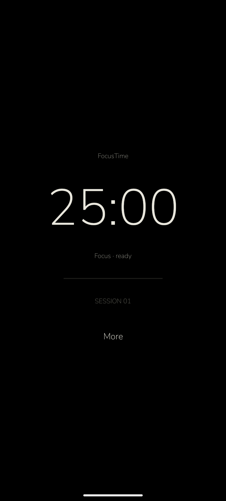
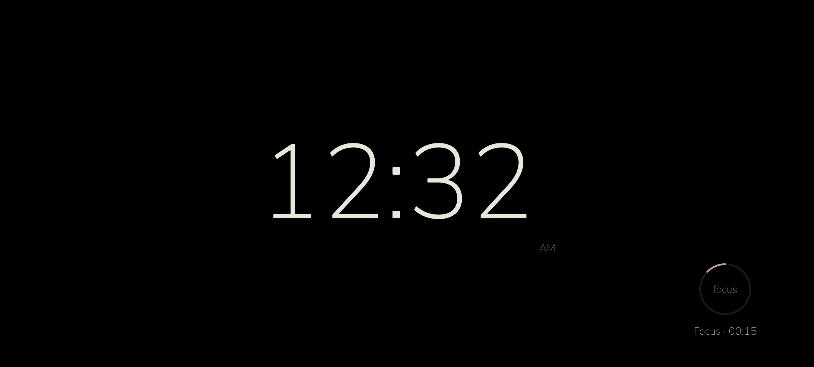
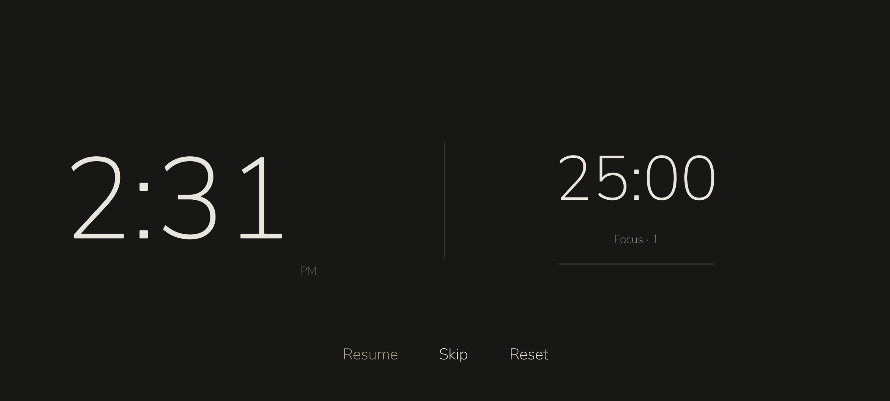
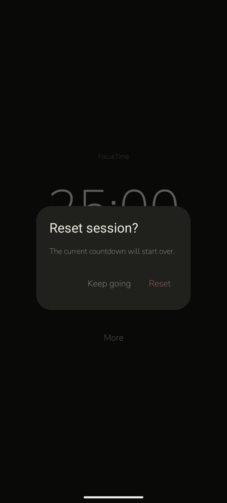

# FocusTime

A native Android Pomodoro timer with an iPhone-StandBy-inspired landscape clock and automatic
Do Not Disturb, built for a Nothing Phone (3a) Lite (`A001T`, Android 16 / API 36).

Kotlin · Jetpack Compose · Material 3 · MVVM · Coroutines/StateFlow · Preferences DataStore.
No account, no network, no analytics, no ads.

| Portrait timer (low power) | Landscape desk clock |
| --- | --- |
|  |  |
| **Circular Pomodoro** | **Growing plant** |
|  |  |
| **Morse code** | **Controls** |
|  |  |
| **Settings** | **Reset confirmation** |
|  |  |

All screenshots are from a Nothing Phone (3a) Lite in the current build; the portrait shot shows
**Low power mode** on.

## Interface

A quiet desk clock, not a dashboard. One large countdown, a small identity line, one contextual
label, and a hairline progress track. Warm quartz surfaces, Nunito Sans with tabular numerals,
and no cards, streaks, charts or chrome.

**Portrait**

- Tap the countdown to start or pause.
- Swipe up to reveal secondary controls (start/pause, skip, reset, settings, stats); swipe down to
  put them away again. A **More** action exposes the same controls for accessibility.
- Long-press the countdown to confirm a reset.
- The status bar is hidden so the timer stays the only thing on screen.

**Landscape**

- A full-screen watch face with the wall clock as the hero and the session beside or beneath it.
- **Four watch faces** — *Desk clock*, *Circular Pomodoro*, *Growing plant* and *Morse code*.
  Swipe left/right anywhere on the face to move between them, or tap **Face** in the controls.
  The choice is stored in DataStore and survives rotation, restarts and updates.
- The controls (pause/resume, skip, reset, face) live in their own strip below the face so they can
  never steal taps from it. Tap the face to show them; they fade after five seconds.
- The **Circular** face keeps the clock dominant and adds a small ring that drains smoothly with
  the session; the ring turns from warm quartz to a neutral grey during breaks.
- The **Plant** face grows a simple stem and leaves from a seed as the focus session progresses and
  returns to a seed during breaks. Growth is continuous and eased; there is no bounce or emoji.
- The **Morse** face shows the Pomodoro countdown large, then encodes the wall clock in real Morse
  code under it — correct dot/dash spacing (1 : 3) and three-unit intra-character, seven-unit
  inter-word gaps. It is static: no random blinking.
- The status and navigation bars are hidden for a true full-screen clock, and the display is kept
  awake only while this screen is visible.
- When the system animator scale is off (reduced motion), ring and plant snap instead of tweening.

**Tutorial**

Three lines — “Tap to begin.”, “Turn your phone sideways.”, “Stay focused. We'll handle
interruptions.” — then *Get started*. It is shown once, stored in DataStore, and replayable from
Settings → Replay tutorial.

**Settings**

Quiet rows only: duration steppers, flow toggles, DND toggle with a live **GRANT** shortcut,
clock format, screen wake, sound/vibration, **Low power mode**, **Landscape watch face**, replay
tutorial, reset statistics and about.

Motion is limited to the countdown, the progress hairline, the watch-face transitions and the sheet
reveal. No bounce, particles, gradients, glows or decorative backgrounds.

**Low power mode**

Draws every background as true `#000000` and dims the remaining surfaces to near-black, so on an
AMOLED panel those pixels are physically switched off. It only saves power on **AMOLED** displays
(Nothing Phone, most OLED phones); on an **LCD** panel the backlight stays lit behind black pixels
and the only effect is the darker look. The app states this in the Settings row and it is off by
default.

## Features

- Focus / short break / long break with configurable durations and long-break interval.
- Timestamp-based countdown: accurate through screen-off, Doze, app backgrounding, process death
  and reboots. No decrementing counter.
- Rotate to landscape for a full-screen, immersive clock with the live session countdown beside it.
  The timer is never reset by rotation; the screen stays awake while the clock is visible.
- Four landscape watch faces with persisted selection: desk clock, circular Pomodoro ring, growing
  plant and an accurate Morse encoding of the local time.
- Low power mode: pure-black, AMOLED-friendly palette with the LCD caveat documented in-app.
- Correct session lifecycle: a new session always starts at the configured duration, pausing freezes
  the remainder, resuming continues from it, and resetting a focus starts a fresh cycle at the
  configured length (no leftover time from the previous session).
- Automatic Do Not Disturb: captures your interruption filter, applies the configured mode for a
  focus session, and restores your filter only if FocusTime still owns the change.
- Foreground service with an ongoing notification: remaining time, pause/resume, skip, reset.
- Session-end alarm as a safety net when the app process and service are gone.
- Local statistics: today, this week, all time, daily goal progress.
- Settings for durations, flow, DND, clock format, screen wake, sound and vibration.

## Requirements

- JDK 17–21 (AGP 8.12 does not support JDK 25).
- Android SDK platform 36 + build-tools 36.0.0.
- Android device with USB debugging, or an emulator (API 26+).

This project was built on Windows with a portable toolchain because the machine only had JDK 25
and no Android SDK:

```text
D:\android-jdk21          Temurin 21.0.13.1
D:\android-sdk            cmdline-tools + platform-tools + platforms;android-36 + build-tools;36.0.0
```

`local.properties` (not committed) must point at the SDK:

```properties
sdk.dir=D:/android-sdk
```

## Build and install

```powershell
cd FocusTime
$env:JAVA_HOME = "D:\android-jdk21"

.\gradlew.bat assembleDebug
adb install -r releases\FocusTime-debug.apk
adb shell am start -n com.rabindra.focustime/.MainActivity
```

The build also produces `app/build/outputs/apk/debug/app-debug.apk`.
`releases/FocusTime-debug.apk` is a copy of that debug build.

## Tests

```powershell
.\gradlew.bat testDebugUnitTest          # 65 JVM tests
.\gradlew.bat connectedDebugAndroidTest  # 7 Compose UI tests on a device
```

Latest run on the Nothing Phone (3a) Lite (`A001T`, Android 16 / API 36):

| Suite | Result |
| --- | --- |
| `testDebugUnitTest` | 65 tests, 0 failures, 0 skipped |
| `connectedDebugAndroidTest` | 7 tests, 0 failures |
| `assembleDebug` | success — `releases/FocusTime-debug.apk` (10.8 MB) |

The UI tests cover the countdown and session label, tap-to-start, the running/paused secondary
controls, the duration stepper, the DND rows in Settings, and the watch-face row with the low
power toggle.

The unit tests now include regressions for the timer reset bugs: a new focus session starts at the
configured duration, elapsed time never carries into a new cycle, reset restores the configured
duration, changing durations while paused clamps the paused remainder, and focus-to-break
transitions rebuild a fresh break length. They also cover `TimerState.progressAt` (the live
remaining share used by the ring and plant) and the Morse encoder's dot/dash units and gaps.

If Gradle test workers fail with `Could not find or load main class Files\Common`, the Windows
`PATH` contains a stray quote (see `C:\Program Files\WSL\"`). Run Gradle with a clean PATH, e.g.
`$env:PATH = "D:\android-jdk21\bin;C:\WINDOWS\system32;C:\WINDOWS"`.

## Architecture

```text
app/src/main/java/com/rabindra/focustime/
├── MainActivity.kt / FocusTimeApplication.kt / AppContainer.kt
├── data/          DataStore repositories (settings, timer state, stats, DND ownership)
├── timer/         Pure state machine, recovery rules, controller, alarm scheduler, receivers
├── dnd/           DND mode, ownership policy (pure), NotificationManager integration
├── notifications/ Channel setup and the foreground TimerService
├── ui/            theme, shared components, dashboard, landscape clock, watch faces, settings
└── util/          Time formatting, Morse encoding, logging
```

- `TimerTransitions` / `TimerRecovery` / `DndPolicy` / `StatsCodec` are pure and unit-tested.
- `PomodoroController` is the single source of truth. In-process countdown uses
  `SystemClock.elapsedRealtime`; persisted deadlines use wall-clock time. Each state change is
  written to DataStore, so an alarm, the service, a reboot or a fresh process all reconcile against
  the same record.
- `TimerService` is a `specialUse` foreground service (a user-initiated countdown with controls),
  not a media hack. It only reflects state; it does not drive the clock.

### Recovery rules

| Persisted state | On restore |
| --- | --- |
| RUNNING, deadline in future | resumes with the saved deadline |
| RUNNING, deadline passed | completes once, records the focus session, next session idle |
| PAUSED | keeps the exact paused remainder, clamped to the current duration setting |
| IDLE | adopts the current duration settings |

Changing a duration in Settings while a session is running does not affect the running session;
when that session ends, the next one is built from the new settings, never from a stale length.
Resetting a focus ends the cycle (back to `SESSION 01`), while resetting a break keeps the cycle
position so the next focus is still numbered correctly.

A long absence can therefore never invent several sessions. Wall-clock changes re-anchor the
deadline to the elapsed-realtime remainder.

### DND semantics

- Applies only for focus sessions, only when the setting is on and policy access is granted.
- Saves `previousFilter` + `appliedFilter` before/after changing the filter.
- On pause/reset/skip/completion: restores the previous filter only if the current filter is still
  the one FocusTime applied. A newer manual filter is left untouched and the saved state is cleared.
- Android 16 keeps an implicit zen rule per package after `setInterruptionFilter()`. FocusTime
  removes its own `implicit_<package>` rule when releasing, so DND can never stay stuck on.
- If access is revoked mid-session, ownership is cleared instead of restoring.

## Permissions

| Permission | Why |
| --- | --- |
| `POST_NOTIFICATIONS` | ongoing timer notification (requested when you first start) |
| `FOREGROUND_SERVICE` + `FOREGROUND_SERVICE_SPECIAL_USE` | user-started session countdown |
| `SCHEDULE_EXACT_ALARM` | exact session-end alarm when permitted; falls back to `setAndAllowWhileIdle` |
| `RECEIVE_BOOT_COMPLETED` | reconcile a session after reboot |
| `VIBRATE` | optional haptic feedback |
| `ACCESS_NOTIFICATION_POLICY` | makes FocusTime appear in Do Not Disturb access; only used when automatic DND is enabled |

No internet, location, storage, overlay or notification-listener permissions.

### Granting DND access

Settings → Apps → Special app access → Do Not Disturb access → FocusTime → Allow modes access.
The in-app Settings screen shows the live status and has a **GRANT** shortcut. Android only lists
apps that declare `ACCESS_NOTIFICATION_POLICY` (this was fixed during device testing).

## Release signing

No signing configuration is included, so `assembleRelease` produces
`app/build/outputs/apk/release/app-release-unsigned.apk`, which is **not installable**. To sign
securely, create a keystore outside the repo and read credentials from environment variables or
`~/.gradle/gradle.properties` — never commit them:

```powershell
keytool -genkeypair -v -keystore "$env:USERPROFILE\focustime-release.jks" `
  -alias focustime -keyalg RSA -keysize 4096 -validity 10000
```

```kotlin
// app/build.gradle.kts
android {
    signingConfigs {
        create("release") {
            storeFile = file(System.getenv("FOCUSTIME_KEYSTORE") ?: "missing.jks")
            storePassword = System.getenv("FOCUSTIME_STORE_PASSWORD")
            keyAlias = "focustime"
            keyPassword = System.getenv("FOCUSTIME_KEY_PASSWORD")
        }
    }
    buildTypes { release { signingConfig = signingConfigs.getByName("release") } }
}
```

## Known limitations

- Exact-alarm permission was not granted on the test device, so the session-end alarm is scheduled
  inexactly; the foreground service remains the primary timer.
- Brightness control in clock mode is not implemented: changing screen brightness requires
  `WRITE_SETTINGS`, which this app deliberately does not request.
- The landscape clock exits by rotating back to portrait.
- Low power mode only reduces panel power on AMOLED screens; on LCD phones it is purely a darker
theme, since the backlight still lights every pixel.
- System bars are hidden throughout the app. A heads-up notification can briefly draw the status
  bar over the timer; it hides itself again once the notification clears.
