# FocusTime

A native Android Pomodoro timer with an iPhone-StandBy-inspired landscape clock and automatic
Do Not Disturb. Built for Android (API 26+), and tested on a Nothing Phone (3a) Lite (`A001T`,
Android 16 / API 36).

Kotlin · Jetpack Compose · Material 3 · MVVM · Coroutines/StateFlow · Preferences DataStore.
No account, no network, no analytics, no ads.

Created by [Rabindra Kumar Meher](https://github.com/rabindra789) and released under the
[MIT License](LICENSE). Download the signed APK from
[Releases](https://github.com/rabindra789/FocusTime/releases/latest).

| Portrait timer (low power) | Landscape desk clock |
| --- | --- |
|  | 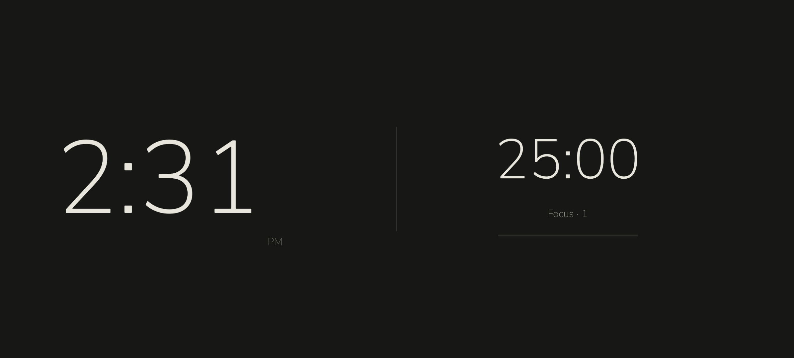 |
| **Analog** | **Circular Pomodoro** |
| 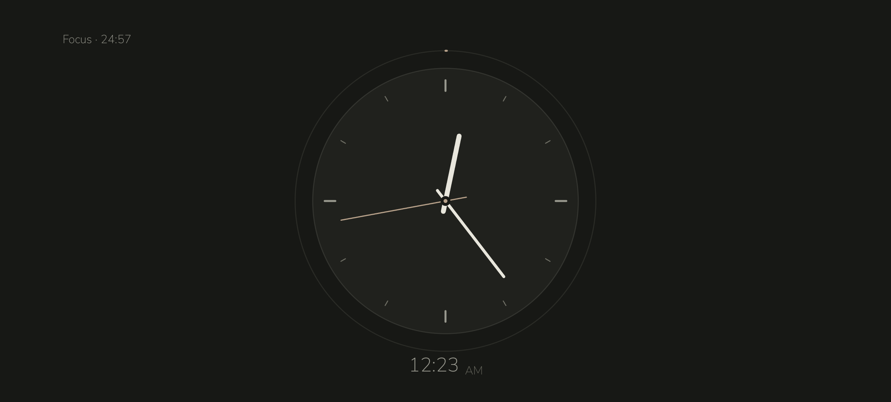 |  |
| **Growing plant** | **Morse code** |
| 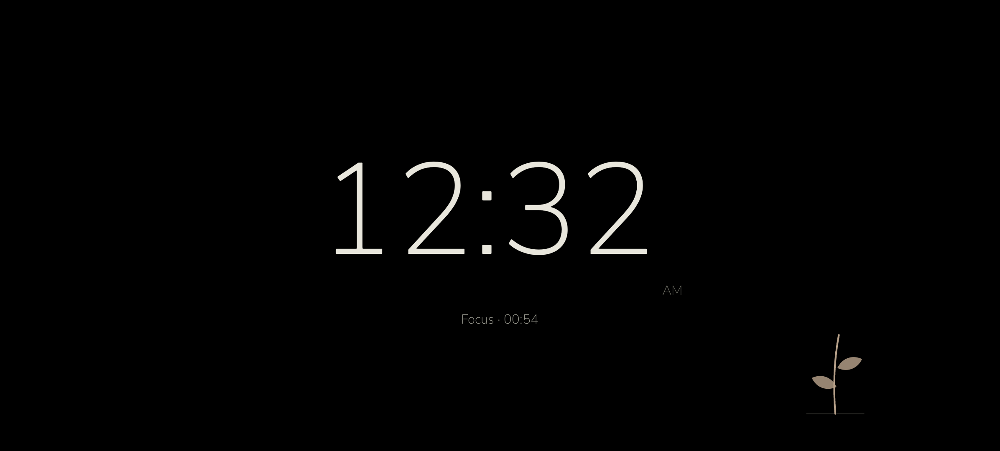 | 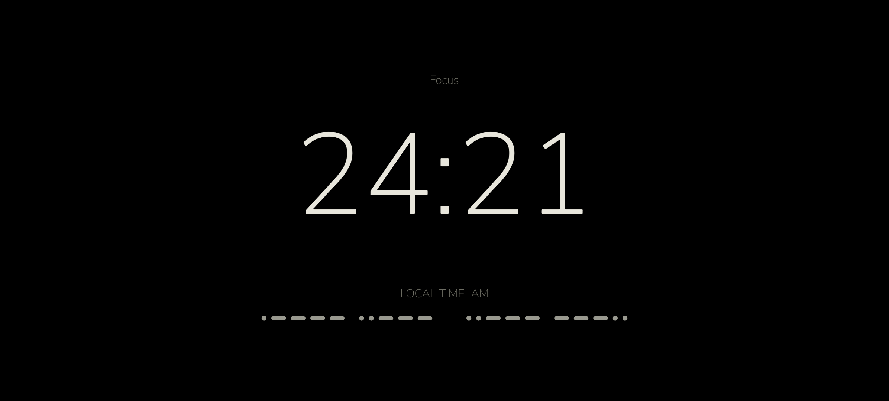 |
| **Forest · sapling** | **Forest · growing** |
| 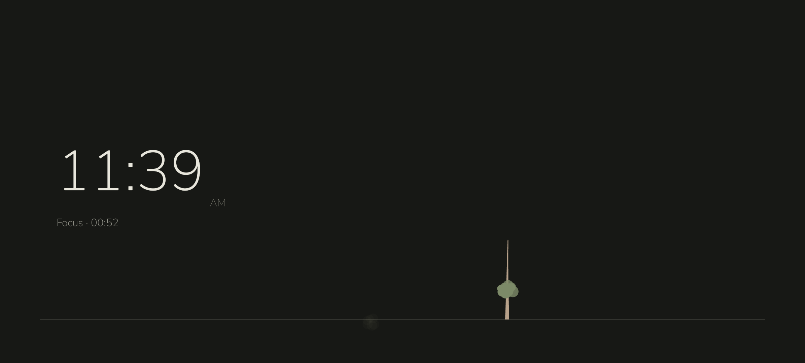 | 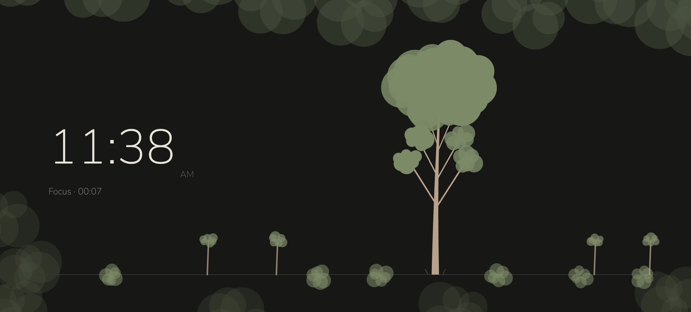 |
| **Forest · full canopy** | **Forest · short break** |
| 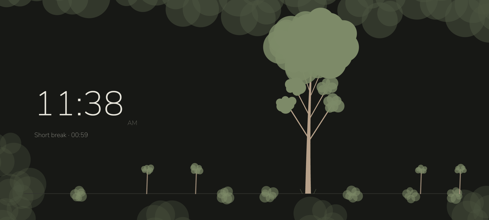 | 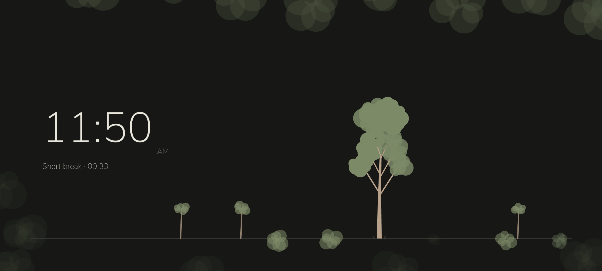 |
| **Forest · long break** | **Controls** |
| 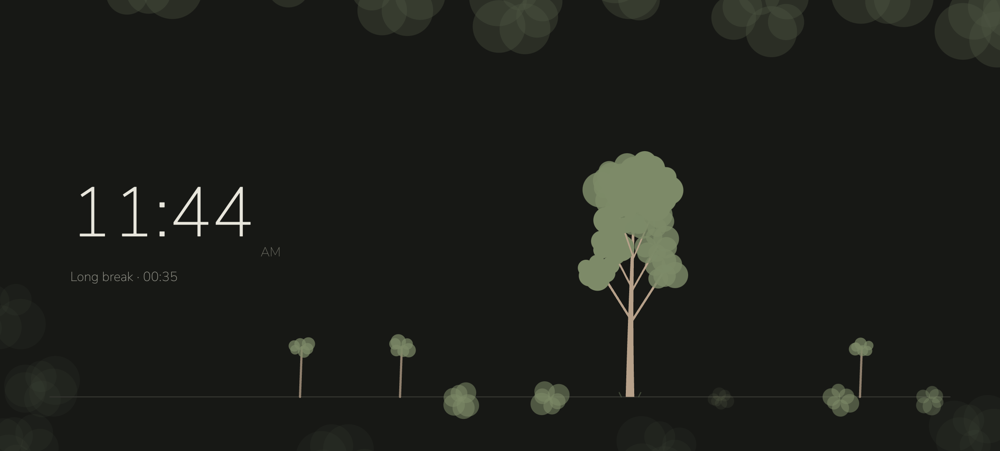 |  |
| **Settings** | **Reset confirmation** |
| 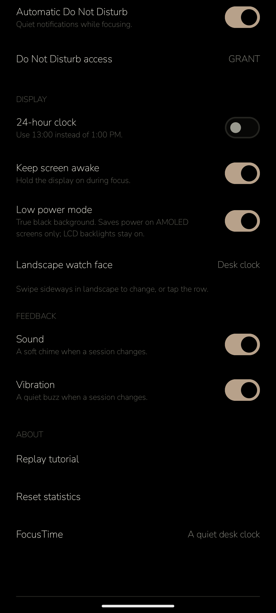 |  |
| **First-run tutorial** | **About** |
| 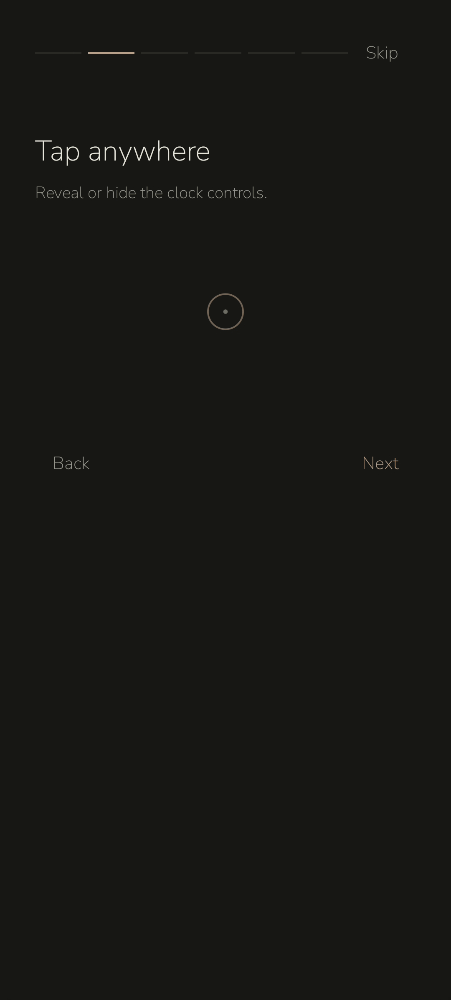 | 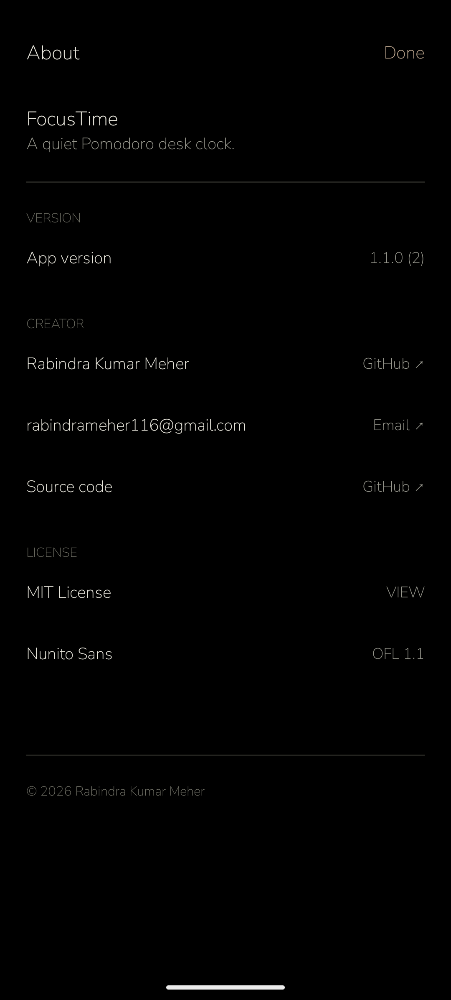 |

All screenshots are from a Nothing Phone (3a) Lite in the current build; the portrait shot shows
**Low power mode** on.

## Interface

A quiet desk clock, not a dashboard. One large countdown, a small identity line, one contextual
label, and a hairline progress track. Warm quartz surfaces, Nunito Sans with tabular numerals,
and no cards, streaks, charts or chrome.

**Gestures**

One gesture layer is shared by the portrait timer and every landscape watch face, so the same
motion always does the same thing and a single detector owns each conflict:

| Gesture | Action |
| --- | --- |
| Tap | Show or hide the controls |
| Double tap | Pause or resume |
| Swipe left / right | Next / previous watch face (stored in DataStore) |
| Swipe up | Skip the session — always asks first |
| Swipe down | Show the compact session panel |
| Long press | Open quick actions (skip, reset; reset always asks first) |

Controls hide themselves after five seconds, so the clock is never crowded by persistent playback
buttons. A tap while a second tap is still possible waits for the double-tap window before it
acts, which is why a tap never starts or stops anything by accident. All gestures are alternative
paths only: the same actions remain available as buttons, TalkBack click and custom actions, and
the touch targets stay at least 48 dp.

**Portrait**

- Tap anywhere to reveal the controls (start/pause, skip, reset, settings, stats); tap again or
  wait five seconds to hide them.
- Double-tap the timer to start, pause or resume without opening the controls.
- Swipe left or right to choose the watch face used when you turn the phone sideways; a short hint
  names the new face. Swipe up to skip (with confirmation) and down for the session panel.
- Long-press for the quick actions.
- The status bar is hidden so the timer stays the only thing on screen.

**Landscape**

- A full-screen watch face with the wall clock as the hero and the session beside or beneath it.
- **Six watch faces** — *Desk clock*, *Analog*, *Circular Pomodoro*, *Growing plant*, *Morse
  code* and *Forest*. Swipe left/right anywhere on the face to move between them, or tap **Face** in the
  controls. The choice is stored in DataStore and survives rotation, restarts and updates.
- The controls (pause/resume, skip, reset, face) live in their own strip below the face so they can
  never steal taps from it. Nothing is shown until you tap the face; the strip fades after five
  seconds, and the double-tap, swipe and long-press gestures work anywhere on the face.
- The **Analog** face is a full-screen quartz desk clock: a large Canvas dial with twelve
  restrained markers, thin hour, minute and second hands, and the digital time small beneath it.
  The second hand glides between the once-a-second ticks; a hairline ring outside the dial shows
  the session's real progress in warm sand for focus, quiet grey for a short break and muted green
  for a long break, freezing and dimming when paused. Idle leaves the ring away entirely and a
  completed session shows a full, still ring with a brief **complete** line. The hour and minute
  hands carry their fractions, so the dial is drawn from the local time itself with no separate
  clock animation.
- The **Circular** face keeps the clock dominant and adds a small ring that drains smoothly with
  the session; the ring turns from warm quartz to a neutral grey during breaks.
- The **Plant** face grows a simple stem and leaves from a seed as the focus session progresses and
  returns to a seed during breaks. Growth is continuous and eased; there is no bounce or emoji.
- The **Morse** face shows the Pomodoro countdown large, then encodes the wall clock in real Morse
  code under it — correct dot/dash spacing (1 : 3) and three-unit intra-character, seven-unit
  inter-word gaps. It is static: no random blinking.
- The **Forest** face grows a single tree into a whole clearing: a sapling at the start of focus,
  branches and leaf clusters opening with elapsed time, young trees at the edges appearing as the
  session deepens, and a canopy along the top and bottom of the screen by the end. It is drawn on
  a Compose `Canvas` from the session's own progress — there is no separate animation clock — with
  a fixed hash placing every leaf, so the forest never reshuffles between frames. During a break
  the greenery clears with the share of the break still to run, leaving a bare trunk by the end.
- The status and navigation bars are hidden for a true full-screen clock, and the display is kept
  awake only while this screen is visible.
- When the system animator scale is off (reduced motion), the rings, plant, forest and analog
  hands snap instead of tweening.

**Automatic flow**

A finished focus hands over to its break without a tap, and a finished break can hand back to
focus. **Start breaks automatically** is on by default; **Start focus automatically** is opt-in, so
the next focus begins only when you have asked for that. Both live in Settings → Flow and are
honoured everywhere the session advances — the in-process ticker, the session-end alarm, process
recreation and reboot. Turning a toggle off is respected: manual pause, skip and reset never start
anything on their own.

This default changed after the first release. Because older builds wrote both toggles as `false`
the first time any preference was saved, a one-time upgrade turns **Start breaks automatically** on
for existing installs and records that it ran; every later choice you make is kept.

**Tutorial**

Six quiet steps on first launch: *Your time. Your focus.*, *Tap anywhere*, *Double tap*, *Swipe
left or right*, *Press and hold*, and *You're ready.* Each step has one line of text, a small
animated demonstration of the gesture, a hairline progress indicator, **Skip** and **Back**, and
**Start focusing** on the last step. The animation holds still when the system animator scale is
off. Completion is stored in DataStore, so the guide never returns on its own; Settings → Replay
tutorial opens it again.

**Settings**

Quiet rows only: duration steppers, flow toggles, DND toggle with a live **GRANT** shortcut,
clock format, screen wake, sound/vibration, **Low power mode**, **Landscape watch face**, replay
tutorial, reset statistics and about.

Motion is limited to the countdown, the progress hairlines and rings, the analog hands, the forest
and plant growth, the watch-face transitions and the sheet reveal. No bounce, particles, gradients, glows or decorative
backgrounds. When the system animator scale is off, the ring, plant and forest snap between values.

**Low power mode**

Draws every background as true `#000000` and dims the remaining surfaces to near-black, so on an
AMOLED panel those pixels are physically switched off. It only saves power on **AMOLED** displays
(Nothing Phone, most OLED phones); on an **LCD** panel the backlight stays lit behind black pixels
and the only effect is the darker look. The app states this in the Settings row and it is off by
default.

## Features

- Focus / short break / long break with configurable durations and long-break interval.
- Timestamp-based countdown: accurate through screen-off, Doze, app backgrounding, process death
  and reboots. No decrementing counter.
- Rotate to landscape for a full-screen, immersive clock with the live session countdown beside it.
  The timer is never reset by rotation; the screen stays awake while the clock is visible.
- Six landscape watch faces with persisted selection: desk clock, an analog quartz dial, circular
  Pomodoro ring, growing plant, an accurate Morse encoding of the local time, and a canvas-drawn
  forest that fills and clears with the session.
- Automatic session flow: a completed focus starts its short or long break immediately (and a
  completed break starts the next focus when that is enabled), with the service, notification,
  alarm and DND all following the new session.
- Low power mode: pure-black, AMOLED-friendly palette with the LCD caveat documented in-app.
- Correct session lifecycle: a new session always starts at the configured duration, pausing freezes
  the remainder, resuming continues from it, and resetting a focus starts a fresh cycle at the
  configured length (no leftover time from the previous session).
- Automatic Do Not Disturb: captures your interruption filter, applies the configured mode for a
  focus session, and restores your filter only if FocusTime still owns the change.
- Foreground service with an ongoing notification: remaining time, pause/resume, skip, reset.
- Session-end alarm as a safety net when the app process and service are gone.
- Local statistics: today, this week, all time, daily goal progress.
- Settings for durations, flow, DND, clock format, screen wake, sound and vibration.

## Requirements

- JDK 17–21 (AGP 8.12 does not support JDK 25).
- Android SDK platform 36 + build-tools 36.0.0.
- Android device with USB debugging, or an emulator (API 26+).

This project was built on Windows with a portable toolchain because the machine only had JDK 25
and no Android SDK:

```text
D:\android-jdk21          Temurin 21.0.13.1
D:\android-sdk            cmdline-tools + platform-tools + platforms;android-36 + build-tools;36.0.0
```

`local.properties` (not committed) must point at the SDK:

```properties
sdk.dir=D:/android-sdk
```

## Build and install

```powershell
cd FocusTime
$env:JAVA_HOME = "D:\android-jdk21"

.\gradlew.bat assembleDebug
adb install -r releases\FocusTime-debug.apk
adb shell am start -n com.rabindra.focustime/.MainActivity
```

The build also produces `app/build/outputs/apk/debug/app-debug.apk`.
`releases/FocusTime-debug.apk` is a copy of that debug build.

For a signed release build:

```powershell
.\gradlew.bat assembleRelease
# app/build/outputs/apk/release/app-release.apk
```

## Download

Every published build is attached to a
[GitHub release](https://github.com/rabindra789/FocusTime/releases); the current one is
`FocusTime-1.1.0.apk` (signed, `versionCode` 2). Sideload it with
`adb install -r FocusTime-1.1.0.apk`. The release build uses the same application id as the debug
build but a different signing key, so uninstall the debug build before switching.

## Tests

```powershell
.\gradlew.bat testDebugUnitTest          # 91 JVM tests
.\gradlew.bat connectedDebugAndroidTest  # 39 Compose UI tests on a device
```

Latest run on the Nothing Phone (3a) Lite (`A001T`, Android 16 / API 36):

| Suite | Result |
| --- | --- |
| `testDebugUnitTest` | 91 tests, 0 failures, 0 skipped |
| `connectedDebugAndroidTest` | 39 tests, 0 failures |
| `assembleDebug` | success — `releases/FocusTime-debug.apk` (10.8 MB) |
| `assembleRelease` | success — signed `app-release.apk` (7.4 MB) |

The UI tests cover the countdown and session label, the duration stepper, the DND rows in Settings,
the watch-face row with the low power toggle, and the About screen's creator, version and in-app
licence text. The Analog suite checks the dial and digital time, 12- and 24-hour formats, focus
progress, short and long breaks, paused/idle/completed states, reduced motion and Low power
rendering, the shared gestures on the face, and that switching away and back leaves the timer
untouched. The gesture suite exercises taps, double taps and long presses, both horizontal
swipes between faces, both vertical swipes, the tap-versus-double-tap and tap-versus-long-press
conflicts, controls auto-hiding, and the confirmations that stop a stray swipe or long press from
skipping or resetting a session; the same layer is checked on the portrait timer and the
landscape face. The tutorial suite covers first launch, stepping forwards and back with the
progress indicator, Skip, the final **Start focusing**, progress across recreation, and the
Settings replay row clearing the stored completion flag.

The unit tests now include regressions for the timer reset bugs: a new focus session starts at the
configured duration, elapsed time never carries into a new cycle, reset restores the configured
duration, changing durations while paused clamps the paused remainder, and focus-to-break
transitions rebuild a fresh break length. They also cover `TimerState.progressAt` (the live
remaining share used by the ring and plant), the plant's focus/break growth mapping, the forest's
growth and clearing mapping with its stable face id, the analog hand angles (including fractional
minutes and the 12-hour dial), and the Morse encoder's dot/dash units and gaps. Automatic flow is covered end to end at the state-machine level: a completed focus starts a
short break, a long break at the configured interval, or nothing when the toggle is off; a
completed break starts focus when configured; a recovered session completes exactly once,starts at its full configured duration from the moment it is detected, and does not invent extra sessions
after a long absence. Gesture classification is unit-tested on its own: drags shorter than the
56 dp threshold are ignored, each direction survives small off-axis movement, and the dominant
axis decides diagonals.

If Gradle test workers fail with `Could not find or load main class Files\Common`, the Windows
`PATH` contains a stray quote (see `C:\Program Files\WSL\"`). Run Gradle with a clean PATH, e.g.
`$env:PATH = "D:\android-jdk21\bin;C:\WINDOWS\system32;C:\WINDOWS"`.

## Architecture

```text
app/src/main/java/com/rabindra/focustime/
├── MainActivity.kt / FocusTimeApplication.kt / AppContainer.kt
├── data/          DataStore repositories (settings, timer state, stats, DND ownership)
├── timer/         Pure state machine, recovery rules, controller, alarm scheduler, receivers
├── dnd/           DND mode, ownership policy (pure), NotificationManager integration
├── notifications/ Channel setup and the foreground TimerService
├── ui/            theme, shared components, dashboard, landscape clock, watch faces, settings
└── util/          Time formatting, Morse encoding, logging
```

- `TimerTransitions` / `TimerRecovery` / `DndPolicy` / `StatsCodec` are pure and unit-tested.
- `PomodoroController` is the single source of truth. In-process countdown uses
  `SystemClock.elapsedRealtime`; persisted deadlines use wall-clock time. Each state change is
  written to DataStore, so an alarm, the service, a reboot or a fresh process all reconcile against
  the same record.
- `TimerService` is a `specialUse` foreground service (a user-initiated countdown with controls),
  not a media hack. It only reflects state; it does not drive the clock.

### Recovery rules

| Persisted state | On restore |
| --- | --- |
| RUNNING, deadline in future | resumes with the saved deadline |
| RUNNING, deadline passed | completes once, records the focus session, and starts the next session when automatic flow is enabled for it (otherwise leaves it idle) |
| PAUSED | keeps the exact paused remainder, clamped to the current duration setting |
| IDLE | adopts the current duration settings |

Changing a duration in Settings while a session is running does not affect the running session;
when that session ends, the next one is built from the new settings, never from a stale length.
Resetting a focus ends the cycle (back to `SESSION 01`), while resetting a break keeps the cycle
position so the next focus is still numbered correctly.

A long absence can therefore never invent several sessions. Wall-clock changes re-anchor the
deadline to the elapsed-realtime remainder.

### DND semantics

- Applies only for focus sessions, only when the setting is on and policy access is granted.
- Saves `previousFilter` + `appliedFilter` before/after changing the filter.
- On pause/reset/skip/completion: restores the previous filter only if the current filter is still
  the one FocusTime applied. A newer manual filter is left untouched and the saved state is cleared.
- Android 16 keeps an implicit zen rule per package after `setInterruptionFilter()`. FocusTime
  removes its own `implicit_<package>` rule when releasing, so DND can never stay stuck on.
- If access is revoked mid-session, ownership is cleared instead of restoring.

## Permissions

| Permission | Why |
| --- | --- |
| `POST_NOTIFICATIONS` | ongoing timer notification (requested when you first start) |
| `FOREGROUND_SERVICE` + `FOREGROUND_SERVICE_SPECIAL_USE` | user-started session countdown |
| `SCHEDULE_EXACT_ALARM` | exact session-end alarm when permitted; falls back to `setAndAllowWhileIdle` |
| `RECEIVE_BOOT_COMPLETED` | reconcile a session after reboot |
| `VIBRATE` | optional haptic feedback |
| `ACCESS_NOTIFICATION_POLICY` | makes FocusTime appear in Do Not Disturb access; only used when automatic DND is enabled |

No internet, location, storage, overlay or notification-listener permissions.

### Granting DND access

Settings → Apps → Special app access → Do Not Disturb access → FocusTime → Allow modes access.
The in-app Settings screen shows the live status and has a **GRANT** shortcut. Android only lists
apps that declare `ACCESS_NOTIFICATION_POLICY` (this was fixed during device testing).

## Release signing

The release build is signed from `keystore.properties` in the repo root, which is **not
committed**, together with the keystore it points at:

```properties
storeFile=keystore/focustime-release.jks
storePassword=…
keyAlias=focustime
keyPassword=…
```

Both `keystore.properties` and `keystore/` are listed in `.gitignore`. `app/build.gradle.kts`
reads the file when it exists and signs the `release` build type with it; without the file,
`assembleRelease` falls back to an unsigned APK. Keep the keystore and its password backed up:
losing them means future builds cannot upgrade an installed release.

Certificate (SHA-256):
`5D:5E:50:E0:ED:1F:C1:75:81:FA:B3:F1:D1:A8:ED:07:FC:3B:7F:D5:91:5E:52:BE:4E:74:95:1C:3E:02:30:38`.

## Creator and license

FocusTime is written by **Rabindra Kumar Meher** —
[github.com/rabindra789](https://github.com/rabindra789),
[rabindrameher116@gmail.com](mailto:rabindrameher116@gmail.com).

The app source is released under the [MIT License](LICENSE), © 2026 Rabindra Kumar Meher.
The Nunito Sans typeface is used under the SIL Open Font License 1.1; the full text ships in
[`licenses/NunitoSans-OFL.txt`](licenses/NunitoSans-OFL.txt). Both licences are readable in the
app under Settings → About FocusTime.

## Known limitations

- Exact-alarm permission was not granted on the test device, so the session-end alarm is scheduled
  inexactly; the foreground service remains the primary timer.
- Brightness control in clock mode is not implemented: changing screen brightness requires
  `WRITE_SETTINGS`, which this app deliberately does not request.
- The landscape clock exits by rotating back to portrait.
- Low power mode only reduces panel power on AMOLED screens; on LCD phones it is purely a darker
theme, since the backlight still lights every pixel.
- System bars are hidden throughout the app. A heads-up notification can briefly draw the status
  bar over the timer; it hides itself again once the notification clears.
